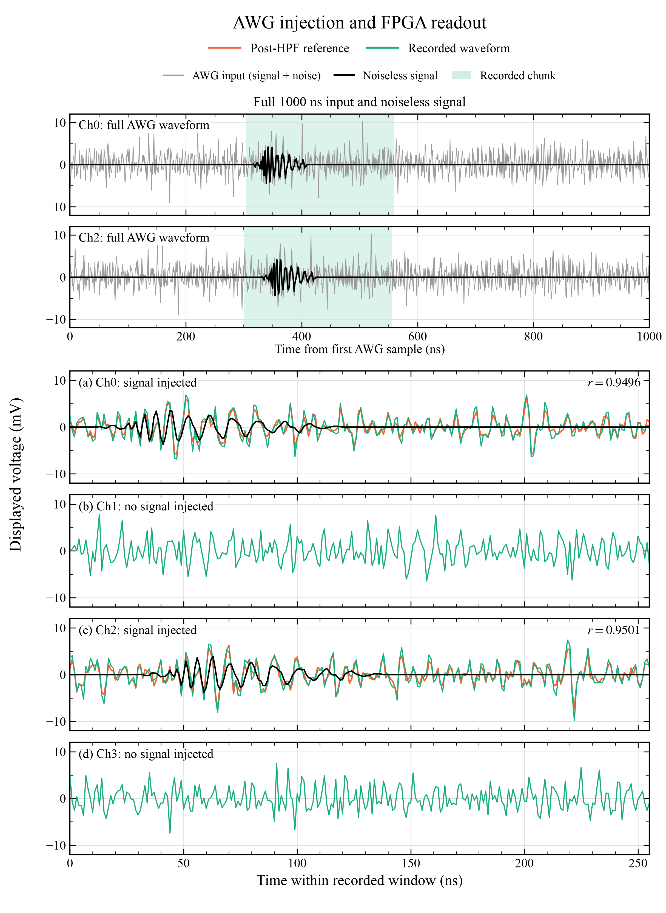

# Four-channel AWG injection and FPGA readout

This figure shows one matched FPGA-recorded event, `ai_event_0003`, on all four
CNN input channels. The AWG signal template was injected into Ch0 and Ch2 only.
Ch1 and Ch3 show the simultaneously recorded background; neither is assigned a
template from the earlier software scans.



## Figure conventions

The title is "AWG injection and FPGA readout". The shortened legend labels are
"Post-HPF reference", "Recorded waveform" and "Noiseless signal"; the latter
continues to denote the user-supplied noiseless estimate described below.

- Green: the recorded ADC waveform on Ch0–Ch3, with the display factors below.
- Orange: the saved quantized frontend HPF reference on Ch0 and Ch2, before CNN
  gain, aligned in time and given the same display factor as the recording.
- The upper two panels show the complete noisy AWG inputs in gray and the
  user-supplied estimated noiseless pulse in black. Translucent green bands
  identify the 256 ns recorded chunks. The pulse intervals are 316–409 ns for Ch0
  and 331–424 ns for Ch2, relative to the first AWG sample; the former Pulse labels
  and bracket markers are omitted. Both the noisy input and pulse include Ch2's
  15 ns cyclic delay.
- The lower Ch0 and Ch2 panels also overlay the estimated noiseless pulse in
  black for visual comparison. The full pulse first passes through the same
  12-bit ADC quantization and fixed-point HPF as the noisy reference, starting
  from zero filter state. It is then cropped and linearly interpolated with the
  existing time alignment. The pulse receives the same display multiplier and
  is not used to compute r. The upper black curves remain before HPF.
- Both reference and recording in **Ch0 and Ch2 are multiplied by 0.90 for
  display**. Ch1 and Ch3 retain a factor of 1.0. The source data are unchanged;
  no amplitude fitting, DC subtraction or RMS normalization is performed.
  The selected final figure omits the per-panel scale annotation; this factor
  remains documented here, in the suggested caption and in the alignment JSON.
- All four panels use the same voltage limits, -12 to +12 mV. Signed ADC codes
  are converted with the nominal 800 mV / 4096-code scale.
- The capture contains 256 samples at 1 ns spacing, plotted at 0–255 ns. The
  overview shading shows the corresponding 256 ns windows in the 1000 ns AWG record.
  The first AWG sample is labelled 0 ns here; its original CSV time was -100 ns.

The upper panels display inputs before ADC quantization and HPF. The lower
reference traces remain the post-HPF noisy references used for the established
readout alignment and correlations. The noiseless pulse overlay is not substituted
into the noisy reference or the correlation calculation. It receives the same
source multiplier 1.400175 and display multiplier 0.90 as the noisy AWG input.
The HPF model reproduces both saved noisy reference channels exactly, ADC code
for ADC code. Its coefficients, state rounding and output rounding are frozen
locally so the pulse overlay does not depend on the current gateware checkout.

Ch0 matches reference samples at approximately 303.5–558.5 ns and Ch2 at
300.3–555.3 ns, relative to the first AWG sample. Pearson correlations are
0.9496 for Ch0 and 0.9501 for Ch2, shown to four decimal places.
Each channel is aligned independently using linear interpolation of
the periodic reference. The fine search step is 0.025 ns; this is an alignment
grid, not a measurement of timing accuracy or an exact trigger-decision time.
Linear interpolation can reduce the reference RMS, so the displayed reference
RMS is not an independent measure of analog-chain gain. Original capture RMS
and explicitly scaled display RMS are stored separately in the alignment JSON.

This is a representative matched readout, not an efficiency or false-trigger
rate measurement. The event CSV contains a timestamp but no CNN score or exact
decision-sample marker, so neither is added to the figure. The other five saved
events were not reliably matched to the injected signal and are not used here.

## Inputs and provenance

- `data/ai_event_0003.csv` is a byte-for-byte copy of the original eight-channel
  event CSV from `Downloads/Triggered`; the first four channels are plotted.
- `data/awg_reference.npz` freezes only the Ch0/Ch2 input and post-HPF references
  from the final fixed-point scan. Ch2 includes the requested 15 ns cyclic shift.
  The source signal files had already received the original factor 1.27 and the
  two subsequent factors 1.05; their names were unchanged by those updates.
- `data/signal_delayed_2rms_noiseless_estimate.csv` is a byte-for-byte copy of
  the unscaled 2rms estimate from `Downloads/signal_delayed_noiseless_estimate`.
  The plotter applies the source multiplier and constructs the delayed Ch2 pulse
  in memory; the source file is unchanged.
- `data/source_manifest.json` records original paths and SHA-256 hashes, the
  channel map, voltage scale and frozen reference provenance. The plotter checks
  the local data hashes before use and does not depend on the original temporary
  scan directory or Downloads files.
- `data/hpf_lookahead.json` freezes the qualified Q16 coefficients and state
  widths used to generate the noisy references and lower pulse overlays.

## Reference amplitude history

The source template received the factors 1.27, 1.05 and 1.05 before the final
fixed-point scan. Their product is 1.400175. The plot then applies a single
factor 0.90 to the time-aligned reference on Ch0 and Ch2. The nominal product
of these user-selected constant factors is **1.2601575 relative to the original
template**. The intermediate display factors 0.78, 0.80 and 0.85 were separate
comparison choices; they were never multiplied together.

Between source scaling and display scaling, the reference passes through
12-bit ADC quantization and the quantized fourth-order HPF, then is cropped and
linearly interpolated for time alignment. These operations can change waveform
RMS, so 1.2601575 is the combined constant multiplier, not an assertion about
the final RMS ratio. Ch2's 15 ns cyclic shift changes time placement, not gain.
The graph does not apply the CNN ingress gains or model RMS normalization.

## Reproduce

Requires Python, NumPy and Matplotlib. From the repository root:

```sh
python3 analysis/icecube_26/plot_awg_trigger_readout.py
```

The default display factor is 0.90. Earlier comparison versions with factors
0.78, 0.80 and 0.85 are retained in separate subdirectories. Both reference and
recording in Ch0 and Ch2 receive the selected factor, with identical axes and
unchanged Ch1/Ch3. For example:

```sh
python3 analysis/icecube_26/plot_awg_trigger_readout.py \
  --signal-display-scale 0.80 \
  --output-dir analysis/icecube_26/figures/display_x0p80
python3 analysis/icecube_26/plot_awg_trigger_readout.py \
  --signal-display-scale 0.85 \
  --output-dir analysis/icecube_26/figures/display_x0p85
```

The script exports the same single figure as a font-embedded vector PDF, an SVG,
and a 300 dpi PNG. `figures/awg_trigger_readout_alignment.json` records the
alignment, physical waveform statistics and software versions. The visual style
uses Times New Roman with a serif fallback, inward ticks on all four sides,
light grids, and the orange/green palette supplied for this presentation.

## Suggested caption

**Four-channel FPGA readout of an AWG-injected waveform.** A 256-sample event is
shown on all four input channels. The upper panels show the complete 1000 ns
noisy AWG inputs in gray and the estimated noiseless pulses in black; green
shading marks the matched recorded windows. Ch2 is cyclically delayed by 15 ns.
The lower panels show the four-channel readout. The signal template was injected
into Ch0 and Ch2; Ch1 and Ch3 contain the simultaneously acquired background.
Green traces are recorded waveforms and orange traces are time-aligned post-HPF
noisy references,
with both reference and recording in Ch0 and Ch2 multiplied by 0.90 for display;
Ch1 and Ch3 retain their original amplitudes. The upper input and pulse traces
use the same display factor. Black curves in the lower Ch0 and Ch2 panels show
the estimated noiseless pulse after the same ADC quantization and HPF as the
noisy reference, with the same time alignment, for visual comparison.
Correlation coefficients for
the two injected channels are 0.9496 (Ch0) and 0.9501 (Ch2).
