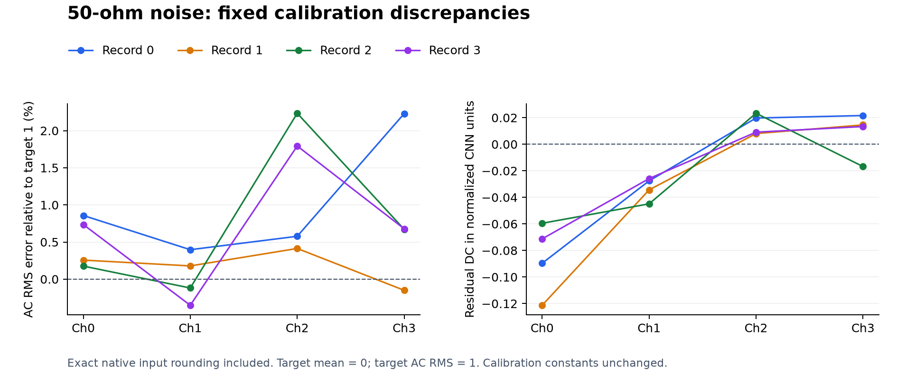

# Four 50-ohm capture calibration audit

The existing calibration produces native normalized AC RMS between
0.996480 and 1.022343 across all 16 recording/channel combinations:
**-0.3520% to +2.2343% relative to target 1**. The most consistent residual
DC is on channel 0: **-0.059538 to -0.121298 normalized units**, or
-0.170057 to -0.344927 mV before gain after subtracting the fixed baseline.
These describe the supplied records, not long-term calibration limits.

## Fixed parameters and definitions

Current constants match the supplied screenshot and the gateware copy.
The following reference AC RMS is `12.5 mV / fixed gain`.

| Channel | Fixed gain | Baseline subtracted (mV) | Reference AC RMS (mV) |
| --- | ---: | ---: | ---: |
| 0 | 4.421578 | -0.468 | 2.827045 |
| 1 | 4.475522 | -0.014 | 2.792970 |
| 2 | 4.417241 | +1.118 | 2.829821 |
| 3 | 4.400045 | +0.585 | 2.840880 |

For each complete CSV channel, `offset = mean(x)` and
`AC RMS = sqrt(mean((x - mean(x))^2))`, using population statistics
(`ddof=0`). This measures the baseline separately from noise amplitude.
Raw total RMS, which includes DC, is also retained in `channel_statistics.csv`.
No per-window mean subtraction or RMS normalization is applied to the data
fed through the fixed hardware model.

The physical-voltage estimate is `(x_mV - fixed_offset_mV) * gain / 12.5`.
For the actual FPGA input, reconstruct signed ADC codes from the CSV, then
use the existing fixed-point conversion, including rounding and saturation:

```text
baseline_codes = fixed_offset_uV * 4096 / 800000
q = clamp(floor((raw_ADC - baseline_codes) * gain / 2 + 0.5), -511, 511)
native_normalized = q / 32
RMS error (%) = 100 * (AC_RMS(native_normalized) - 1)
```

Native normalized mean should be zero; its AC RMS should be one. Total RMS
alone mixes these two quantities and can conceal residual DC.

## Per-record results

Record 0 has 12,288 samples per channel. Records 1, 2 and 3 each have 16,384.
Record number refers to the suffix in `all_channels_ampl_50Ohm_N.csv`.
All raw voltage columns below are mV. Normalized columns include the exact
native fixed-point input quantization. Offset error is measured mean minus
the fixed baseline, before gain.

| Record | Ch | Measured offset | AC RMS | Offset error | Normalized mean | Normalized AC RMS | RMS error (%) |
| --- | --- | ---: | ---: | ---: | ---: | ---: | ---: |
| 0 | 0 | -0.723143 | 2.852377 | -0.255143 | -0.089658 | 1.008574 | +0.8574 |
| 0 | 1 | -0.089785 | 2.805290 | -0.075785 | -0.027573 | 1.003967 | +0.3967 |
| 0 | 2 | +1.174849 | 2.848026 | +0.056849 | +0.019742 | 1.005774 | +0.5774 |
| 0 | 3 | +0.647782 | 2.905565 | +0.062782 | +0.021619 | 1.022300 | +2.2300 |
| 1 | 0 | -0.812927 | 2.835667 | -0.344927 | -0.121298 | 1.002565 | +0.2565 |
| 1 | 1 | -0.108915 | 2.799530 | -0.094915 | -0.034374 | 1.001784 | +0.1784 |
| 1 | 2 | +1.142046 | 2.843342 | +0.024046 | +0.008039 | 1.004134 | +0.4134 |
| 1 | 3 | +0.627562 | 2.837604 | +0.042562 | +0.014557 | 0.998500 | -0.1500 |
| 2 | 0 | -0.638057 | 2.833470 | -0.170057 | -0.059538 | 1.001758 | +0.1758 |
| 2 | 1 | -0.138267 | 2.791098 | -0.124267 | -0.044886 | 0.998808 | -0.1192 |
| 2 | 2 | +1.185054 | 2.895042 | +0.067054 | +0.023323 | 1.022343 | +2.2343 |
| 2 | 3 | +0.538791 | 2.861179 | -0.046209 | -0.016788 | 1.006711 | +0.6711 |
| 3 | 0 | -0.671524 | 2.848813 | -0.203524 | -0.071287 | 1.007356 | +0.7356 |
| 3 | 1 | -0.084907 | 2.784403 | -0.070907 | -0.025877 | 0.996480 | -0.3520 |
| 3 | 2 | +1.145171 | 2.882188 | +0.027171 | +0.009109 | 1.017938 | +1.7938 |
| 3 | 3 | +0.624175 | 2.861645 | +0.039175 | +0.013327 | 1.006786 | +0.6786 |

Channel 0's gain-related RMS discrepancy is +0.18% to +0.86%, while its
residual mean reaches approximately -0.12 of the target unit RMS. Its
measured baseline is more negative than the fixed -0.468 mV in every record.
Channel 1 also retains negative DC, -0.025877 to -0.044886 normalized units.
Channels 2 and 3 have smaller DC residuals, but show the largest measured
RMS discrepancies, +2.2343% and +2.2300% in individual records.

The AC RMS is mathematically independent of a constant baseline subtraction
before quantization. Correcting a DC mismatch therefore does not itself
correct a noise-scale mismatch. The measured residuals are not explained by
the 1 microvolt offset configuration step or one-part-per-million gain
rounding. Their dependence on acquisition conditions cannot be determined
from these files alone. Input RMS/DC statistics also do not determine the
resulting CNN score or false-trigger rate.



## Checks and provenance

- 61,440 samples per channel in total, 245,760 channel samples.
- Four source hashes, lengths, raw ranges and reconstruction checks are in
  `results.json`. No missing/nonfinite values, discarded rows or clipping.
- Every value lies on the CSV exporter's 800 mV / 4094-code lattice to
  within 0.000000656 mV. The original ADC integer codes recovered using
  4094 or 4096 agree for every sample in these captures.
- Hardware uses 800 mV / 4096 codes. Consequently the native unquantized
  amplitude is 4094/4096 of a direct CSV-mV estimate. The approximately
  0.0488% scale difference is included in the normalized results above.
- All samples match the previously qualified independent native HLS input
  conversion table. All 66 source-closure entries and the table checksum
  were rechecked; the three calibration packages also match the gateware
  copies byte-for-byte.
- CSV means and variances independently agree with `math.fsum` reductions.
  Exact integer histograms independently verify native means and variances.
- Quantization error RMS is 0.008818 to 0.009076 model units. Its effect on
  the resulting AC RMS is at most 0.020485 percentage points. No ADC
  endpoint or native saturation code occurs in these files.
- Both raw total RMS and native total RMS, post-gain mV statistics and all
  full-precision per-channel values are retained in `channel_statistics.csv`
  and `results.json`.

The analysis uses the current source snapshot `30a3799`, bundled Python/
NumPy, and the previously qualified native conversion table. Production RTL,
calibration values, gateware, bitstream and the original CSV files are
unchanged. No push or board programming was performed.

## Reproduce

Run the retained `analyze.py` with `--root` pointing to AI-Trigger-System,
`--input-dir` pointing to the four source CSVs, and `--output` naming a new
directory. It uses the qualified reference and source manifest under
`build/channel_gain_offset_20261015/`. Exact checksums of the retained
analysis files are listed in `SHA256SUMS`.
